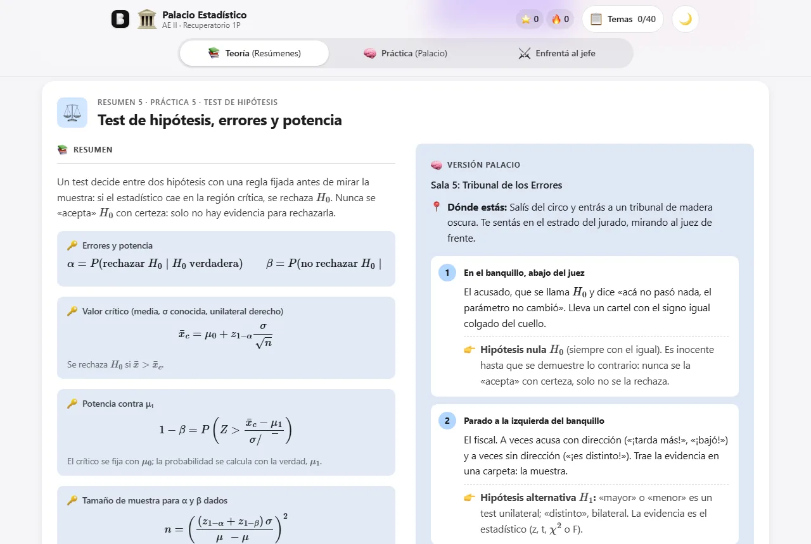
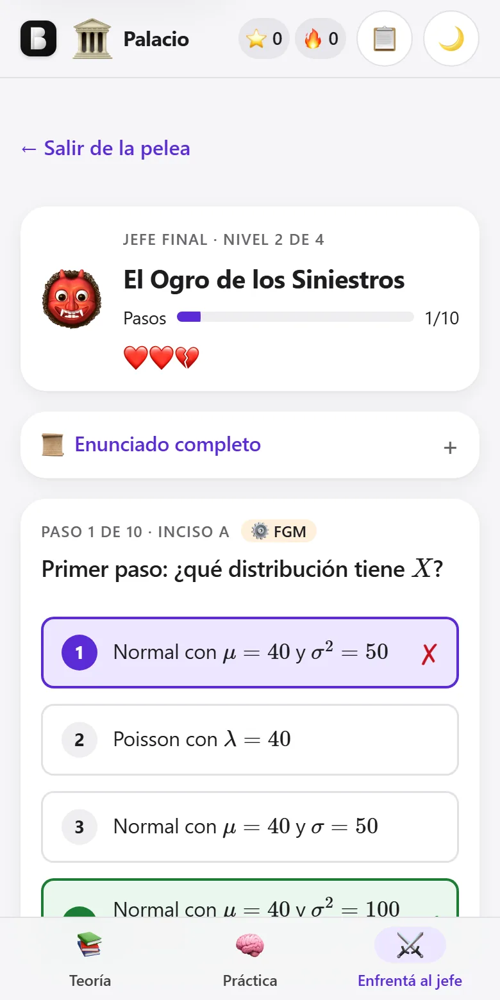

# Palacio Estadístico · Análisis Estadístico II

Página de estudio para el **recuperatorio del 1er parcial de Análisis Estadístico II** de la Facultad de Ciencias Económicas de la UBA (cátedra Tito Lasanta, 2.º cuatrimestre de 2026). Cubre estimadores, función generatriz de momentos, distribuciones en el muestreo, intervalos de confianza y test de hipótesis (con potencia).

**👉 Abrir la página: https://matiasbellidor.github.io/REC1PAE2/**



## Para qué sirve

Junta en un solo lugar lo que hace falta antes de un parcial: entender la teoría, memorizar las fórmulas y practicar con ejercicios de la cátedra. Funciona en la compu y en el celular, sin crear una cuenta ni instalar nada.

## Cómo se usa

La página tiene tres pestañas y un botón de temas. Una forma de recorrerla:

1. **Teoría:** leé el resumen del tema. Al lado tiene su versión palacio, para estudiarlo de las dos maneras.
2. **Práctica:** entrá a la sala del mismo tema. Antes de jugar, cerrá los ojos y recorré la escena estación por estación; después respondé las preguntas y vencé al jefe de la sala.
3. **Enfrentá al jefe:** cuando ya manejes los temas, probá los problemas integradores, que cruzan varios temas y se resuelven paso a paso.
4. **Temas (botón 📋 del encabezado):** tachá cada tema cuando lo domines y mirá cuántos te faltan.

## Qué tiene

### 📚 Teoría (Resúmenes)
Seis resúmenes, uno por tema, con las fórmulas clave resaltadas. Cada uno tiene dos versiones, una al lado de la otra: el **resumen normal** y su **versión palacio**.

| Resumen | Temas |
|---|---|
| Estimadores | Sesgo, error cuadrático medio, eficiencia, consistencia, máxima verosimilitud y cota de Cramér-Rao |
| FGM | Función generatriz de momentos, cumulante, transformaciones lineales y sumas de independientes |
| Muestreo | Normal, χ², t y F; medias, proporciones, varianzas y diferencias |
| Intervalos | Media, proporción, varianza, diferencias, cociente de varianzas y tamaño de muestra |
| Tests y potencia | Errores de tipo I y II, valor crítico, p-valor, diferencia de medias y potencia |
| ANOVA (extra) | No aparece en las prácticas ni en los parciales; está para ver que con dos poblaciones es el test t |

### 🧠 Práctica (Palacio de la memoria)
Seis salas que se recorren siempre en el mismo orden: el Salón de los Espejos, la Fábrica de Momentos, el Bosque de los Grados de Libertad, la Red de Seguridad, el Tribunal de los Errores y la Torre de las Poblaciones. Cada sala guarda un tema con una escena exagerada, escrita en castellano rioplatense: cada estación dice dónde está, qué ves y qué concepto representa.

Cada sala tiene preguntas de las Prácticas 1 a 5 y un **jefe que es un ejercicio real de los parciales del 1C 2026** (Temas 1, 2 y B), copiado tal cual, con sus erratas. Si errás, ves la resolución paso a paso con la historia del palacio y la pregunta vuelve al final.


### ⚔️ Enfrentá al jefe
Cuatro jefes integradores (🦈, 👹, 🐙 y 🧛) de dificultad creciente, con 36 pasos en total. Cada paso usa lo que sacaste en el anterior: por ejemplo, de una FGM a una binomial, a un estimador, a un intervalo, a un test y a su potencia. Tenés 3 corazones: si errás, perdés uno, ves la resolución y seguís con el paso siguiente.

Estos problemas están armados para practicar: **no son de la cátedra**. Los ejercicios reales están en el jefe de cada sala de Práctica.



### 📋 Temas del parcial
Una lista de 40 temas y subtemas, agrupados por práctica, para ir tachando. Tiene barra de progreso, un link al resumen de cada grupo y un botón para desmarcar todo.

### 🧮 Calculadora temporal
Al lado de cada pregunta (abajo, desplegable, en el celular). Tiene tres herramientas:

- **Cuentas:** con coma o punto decimal, `sqrt( )`, `ln( )`, `exp( )`, `fact(n)` y `comb(n; k)`.
- **Límite n → ∞:** evalúa una fórmula en función de *n* para n = 10 hasta 1.000.000 (por ejemplo, la varianza de un estimador) y muestra hacia dónde va.
- **Tablas:** Z, t, χ², F, binomial y Poisson, con probabilidades y valores de tabla.

Solo da números: decidir si un estimador es consistente o si se rechaza una hipótesis lo hacés vos.

### Además
- Puntos de experiencia y racha de respuestas correctas.
- El progreso y los temas tachados se guardan solo en tu navegador. No hay cuentas, cookies ni analítica, y los podés borrar desde el pie de la página.
- Tema claro y oscuro.
- Se puede usar con el teclado: las teclas 1 a 4 eligen una opción y Enter confirma.

## Hacé tu propia versión (fork y clonado)

Si querés cambiar los resúmenes, sumar preguntas o adaptarla a otra materia, podés tener tu copia publicada desde tu cuenta de GitHub, gratis:

1. Tocá **Fork**, arriba a la derecha de este repositorio, para crear una copia en tu cuenta.
2. En tu copia, entrá a **Settings → Pages**, elegí **Deploy from a branch**, la rama **`main`** y la carpeta **`/ (root)`**, y guardá.
3. En uno o dos minutos tu versión queda publicada en `https://<tu-usuario>.github.io/REC1PAE2/`. Cada cambio que subas a `main` se publica solo.

Para trabajar en tu compu, clonala (con el botón **Code** o con GitHub Desktop) o desde la terminal:

```bash
git clone https://github.com/<tu-usuario>/REC1PAE2.git
cd REC1PAE2
python -m http.server 8000
```

Después abrí `http://localhost:8000` en el navegador. También funciona abriendo `index.html` con doble clic, pero conviene el servidor local. Hace falta internet la primera vez, porque las fórmulas las dibuja MathJax desde un CDN. Es un sitio estático (un solo `index.html`, sin compilar nada), así que también lo podés publicar en Vercel o Netlify importando el repositorio.

### Qué tocar para cambiar el contenido

Todo vive en `index.html`, en bloques de datos separados del motor:

| Qué querés cambiar | Dónde |
|---|---|
| Salas, escenas del palacio, preguntas y jefes de sala | `PALACIO.levels` (primer bloque de datos) |
| Resúmenes de Teoría | `PALACIO.theory` (segundo bloque de datos, con `finals` y `topics`) |
| Jefes de «Enfrentá al jefe» | `PALACIO.finals` |
| Lista de temas para tachar | `PALACIO.topics` |
| Colores, tipografía y espaciado | Variables CSS al principio de `<style>` (`:root`) |

Algunas reglas para no romper nada:

- Los textos con fórmulas se escriben con ``R`...` `` (`String.raw`) y LaTeX entre `\( ... \)`. Para «menor que» dentro de una fórmula usá `\lt`, no `<`.
- En las preguntas de opción múltiple (`type: 'mc'`), `opts[0]` es **siempre la correcta**: la página mezcla el orden al mostrarla. En las numéricas (`type: 'num'`) van `ans` y `tol` (tolerancia).
- Cada pregunta lleva un `id` único, un `why` (la explicación con la historia del palacio) y `steps` (la resolución paso a paso).
- Los emojis son imágenes de Apple en `emojis/` (el nombre del archivo está en el mapa `EMO_SRC` del motor). Si agregás uno, sumá su archivo y su línea en ese mapa.

## Fuentes y aviso

- Material de la cátedra: Parcial AEII 1C 2026 (Temas 1, 2 y B), Prácticas 1 a 5, Ejercicios de Estimadores, de Muestreo y de FGM, Ejercitación de potencia del test y las presentaciones de teoría. Las soluciones se verificaron numéricamente con SciPy; si algo no coincide con lo que da la cátedra, gana la cátedra.
- Los resúmenes, las historias del palacio y los jefes de «Enfrentá al jefe» son material propio de estudio.
- Este no es un sitio oficial de la Universidad de Buenos Aires ni de la cátedra. El sello de la UBA (dominio público) y el escudo de la Facultad de Ciencias Económicas solo identifican la institución donde se cursa la materia.
- Emojis designed by Apple. Used for educational purposes. LinkedIn es marca de su dueño.

## Autor

Creado por **Matias Rodrigo Bellido**, estudiante de Ciencias Actuariales en la FCE-UBA. [Conectá conmigo en LinkedIn](https://www.linkedin.com/in/matiasbellido/) o escribime tus consultas a rbellidomatias@gmail.com.

© 2026 Matias Rodrigo Bellido. Todos los derechos reservados.
